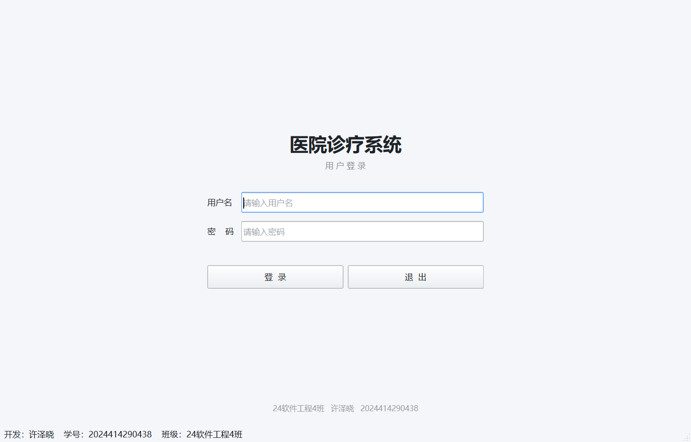
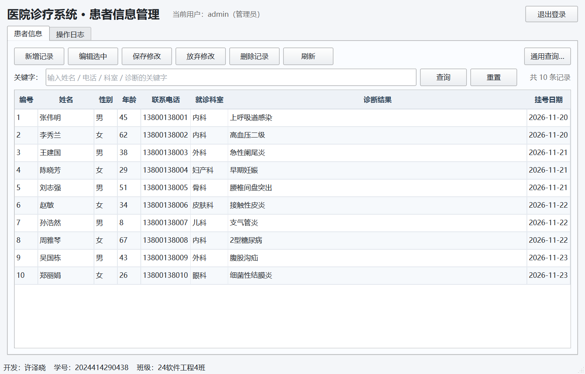
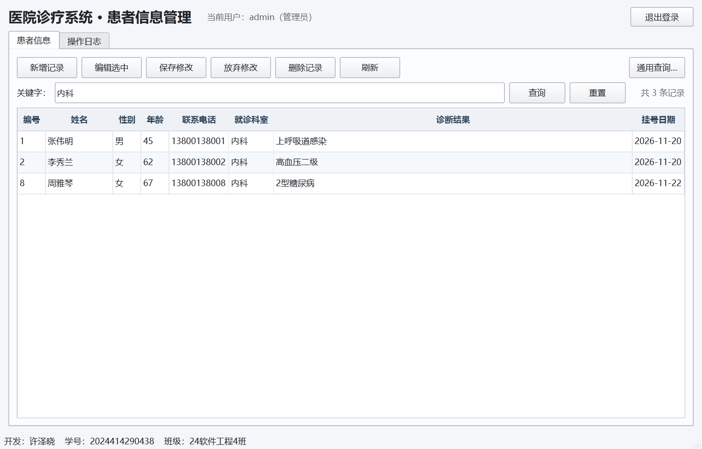
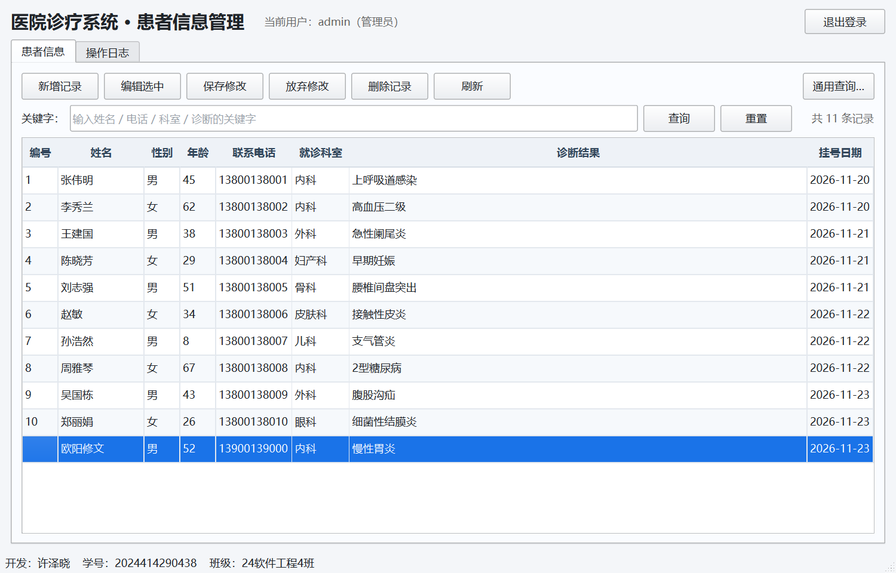
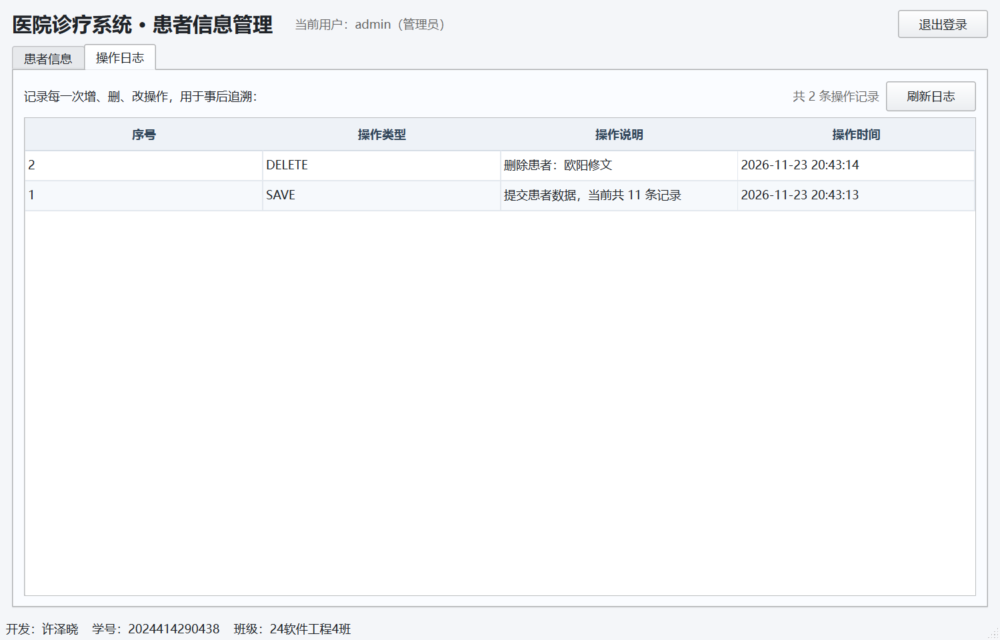

# 医院诊疗系统（Qt6 + SQLite）

软件工程实验三：Qt SQL 数据库模块与 View-Model 结构的使用。

一个可以真正跑起来的桌面端患者信息管理系统。登录、患者增删改查、关键字检索、通用查询、操作日志，全部基于 Qt 的 Model/View 架构实现，界面与数据处理分层，没有把 SQL 散落在按钮的槽函数里。

开发：许泽晓　2024414290438　24软件工程4班

---

## 界面

登录页采用左侧信息、右侧表单的布局，账号或密码错误时给出不同提示，不笼统地说"登录失败"。



主界面用 QTableView 绑定 QSqlTableModel，直接显示数据库里的真实记录，共 8 列，性别和科室走下拉代理，年龄走数字框代理。



关键字检索同时匹配姓名、电话、科室、诊断四个字段，输入"内科"即筛出内科患者，记录数实时更新。



新增记录时，未提交的行显示为带星号的草稿状态，保存时统一做必填校验。



每次增删改都会写入操作日志表，可以看到操作类型、描述和精确到秒的时间。



---

## 功能

（1）登录校验用参数绑定（`prepare` + `addBindValue`），而不是把用户输入拼进 SQL 字符串，从根上堵住 SQL 注入。用户名不存在与密码错误会分别提示，两种情况的处理路径也不同。

（2）患者列表用 `QSqlTableModel` 绑定，编辑策略设为 `OnManualSubmit`，界面上改了不会立刻写库，统一由"保存"按钮触发 `submitAll()`，便于在写库之前做一次完整的必填校验。

（3）新增、修改、删除都有前置检查。删除前弹确认框，写库失败则调用 `revertAll()` 回滚，避免界面显示已经删了、数据库里其实还在。

（4）性别、科室两个字段用自定义代理 `QStyledItemDelegate` 换成 QComboBox，年龄字段换成带范围限制的数字框，重写了 `createEditor`、`setEditorData`、`setModelData` 三个函数。

（5）另有一个独立的通用查询窗口，用 `QSqlQuery` 手写 SQL、`QSqlQueryModel` 只读展示，支持按科室、性别、年龄区间组合筛选，用于展示"可写模型"与"只读模型"的区别。

（6）查询无结果时，表格区域会显示一行提示文字，而不是留一片空白让人以为程序卡住了。

（7）操作日志表记录每次增删改，方便核对"界面上做了什么、数据库里发生了什么"。

---

## 环境要求

Qt 6.11.2（MinGW 13.1 64bit 套件）、CMake 3.16 以上、C++17。

不需要单独安装数据库服务。程序用的是 Qt 自带的 `QSQLITE` 驱动，数据库就是一个 `hospital.db` 文件。

> 如果你的 Qt 装的是官方安装包，`plugins/sqldrivers/` 下默认带 `qsqlite.dll`，开箱可用。MySQL 驱动从 Qt5 后期起就不再随安装包提供了，需要自己用源码编译，这也是本工程选 SQLite 的现实原因。

---

## 编译运行

用 Qt Creator 打开 `CMakeLists.txt`，选择 MinGW 64bit 套件，`Ctrl+R` 即可。

命令行构建：

```bash
cmake -S . -B build -G Ninja \
      -DCMAKE_PREFIX_PATH=<Qt安装目录>/6.11.2/mingw_64 \
      -DCMAKE_CXX_COMPILER=<Qt安装目录>/Tools/mingw1310_64/bin/g++.exe \
      -DCMAKE_C_COMPILER=<Qt安装目录>/Tools/mingw1310_64/bin/gcc.exe
cmake --build build
```

**关于数据库**：仓库里没有放 `hospital.db`（里面存着明文密码，不适合进版本库）。程序启动时会按下面的顺序找库，都找不到就在可执行文件旁边新建一个，表结构和初始数据一起建好，所以 clone 下来直接就能跑：

1. 环境变量 `HOSPITAL_DB` 指定的路径
2. 从可执行文件所在目录往上逐级查找 `db/hospital.db` 和 `HospitalDB/hospital.db`
3. 都没找到，就在可执行文件目录新建 `hospital.db`

想演示"数据库连接失败"这个场景，把 `HOSPITAL_DB` 指向一个不存在的路径即可，程序会弹出带具体错误原因的提示框然后退出，不会带着一个坏连接继续跑。

### 默认账号

`admin` / `123456`（管理员），`doctor` / `888888`（医生）。

---

## 数据表设计

三张表。`users` 存登录账号，`username` 加了唯一约束；`patients` 是主业务表，八个字段覆盖姓名、性别、年龄、电话、科室、诊断、挂号日期，其中 `phone` 特意加了 UNIQUE —— 这不是随手加的，而是为了让"重复数据"这个异常场景有地方发生，测试时插入重复号码会被数据库层面直接拒绝；`logs` 是操作日志，`op_time` 用 `datetime('now','localtime')` 自动填当前时间。

建表语句在 `db/create_db.sql`，可以直接贴进 Navicat 或 DB Browser for SQLite 执行并截图。`db/make_db.py` 是用来一键把数据库恢复到初始状态的辅助脚本（跑测试把数据改乱了可以用它还原）。

---

## 目录结构

```
Hospital/
├── main.cpp            程序入口：初始化界面、连数据库、开窗口
├── dbhelper.h/.cpp     数据库连接管理（单例）+ 自动建库
├── loginpage.h/.cpp    登录页
├── patientpage.h/.cpp  患者信息管理页（增删改查的主界面）
├── advquerydialog.h/.cpp  通用查询窗口（只读）
├── logpage.h/.cpp      操作日志页
├── delegates.h/.cpp    自定义代理：性别/科室下拉框、年龄数字框
├── uistyle.h/.cpp      统一浅色主题与控件样式
├── mainwindow.h/.cpp   主窗口，用 QStackedWidget 切换登录页与主界面
└── db/
    ├── create_db.sql   建表脚本
    └── make_db.py      数据库重置脚本
```

分层和实验要求的 MVC 是对应的：`DbHelper` 和 `QSqlTableModel` 属于模型层，负责数据；各个 `*Page` 是视图层，只管显示；`MainWindow` 和页面里的槽函数是控制层，负责把用户操作翻译成对模型的操作。界面全部用代码创建，没有用 `.ui` 文件的拖拽布局，这样每个控件的位置和属性在代码里都能查到，也方便在报告里贴代码说明。

---

## 两个值得说的实现细节

**SQL 注入是实际验证过的，不是照抄结论。** 最初写的登录是拼接字符串的版本，把用户名输入成 `admin' --`、密码随便填，能直接登进去 —— 因为 `--` 把后面的密码判断整段注释掉了。后来改成 `prepare` + `addBindValue`，同样的输入查出来是 0 行，注入失效。这两种写法的对比结果写进了实验报告的"AI 辅助开发过程"一节。

**`OnManualSubmit` 配 `submitAll` 是一对，忘一个就出错。** 如果用可编辑模型却忘了提交，界面上数字改了、看着也变了，关掉程序重开发现全没了 —— 数据只在内存里。这个坑在调试时真实遇到过一次，后来把"保存"按钮和 `submitAll()` 绑在一起，并在提交前跑一遍必填校验，校验不过就 `revertAll()` 把内存里的改动丢掉，保证界面和数据库始终一致。

---

## 提交记录

工程按开发顺序分成 7 次提交，对应实验的七个步骤：

```
初始化 Qt Widgets 工程，主窗口用 QStackedWidget 承载登录页与主界面
设计数据库：users / patients / logs 三张表与初始数据
添加数据库连接模块 DbHelper（单例）
实现登录校验：区分用户名不存在与密码错误，用参数绑定防注入
患者信息管理：QSqlTableModel 绑定表格，支持查询、新增、修改、删除
通用查询窗口（QSqlQuery + QSqlQueryModel）与操作日志页
补充实验报告：七个步骤的代码与运行截图、AI 辅助过程、测试结果
```
